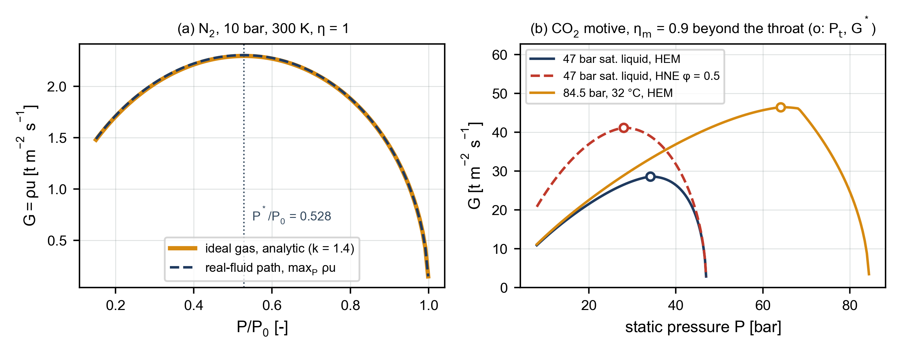

.. _flow_fundamentals:

===============================
One-Dimensional Real-Fluid Flow
===============================

Every part of the ejector model is built from one relation: the adiabatic
acceleration of a stream from a stagnation state. This chapter states that
relation for a real fluid and shows how choking follows from it without an
explicit speed of sound. It then covers the homogeneous treatment of flashing
flow, the delayed-flashing correction, and the triple-point limit.

.. _sec-expansion-path:

Adiabatic expansion from a stagnation state
===========================================

A stream with stagnation state :math:`(P_0, h_0, s_0, \vec z)` accelerates
adiabatically to static pressure :math:`P`. The steady energy equation gives
the velocity:

.. math::
   :label: eq-velocity

   h_0 = h + \tfrac{1}{2}u^2 \qquad\Longrightarrow\qquad u(P) = \sqrt{2\,\bigl(h_0 - h(P)\bigr)} .

Losses are expressed through an **isentropic efficiency** :math:`\eta`. The
enthalpy drop is a fraction :math:`\eta` of the isentropic one:

.. math::
   :label: eq-expansion-path

   h(P) = h_0 - \eta\,\bigl(h_0 - h_\mathrm{s}(P)\bigr), \qquad
   h_\mathrm{s}(P) = h(P, s_0, \vec z) ,

so one point on the path costs one PS flash (for :math:`h_\mathrm{s}`) and one
PH flash (for the state at :math:`(P, h)`). The PH flash returns the density
:math:`\rho(P)` and, when two-phase, the phase densities. The local **mass flux**
follows as

.. math::
   :label: eq-mass-flux

   G(P) = \rho(P)\,u(P) .

The same path describes the acceleration of the suction stream into the mixing
section (:math:`\eta = \eta_\mathrm{s}` over the whole path) and the motive
nozzle. In the motive nozzle the converging section is taken as **isentropic**,
and :math:`\eta_\mathrm{m}` acts only on the expansion beyond the throat
pressure :math:`P_\mathrm{t}`:

.. math::
   :label: eq-motive-path

   h(P) = \begin{cases}
   h_\mathrm{s}(P), & P \ge P_\mathrm{t},\\[2pt]
   h_\mathrm{s}(P_\mathrm{t}) - \eta_\mathrm{m}\,\bigl(h_\mathrm{s}(P_\mathrm{t}) - h_\mathrm{s}(P)\bigr), & P < P_\mathrm{t}.
   \end{cases}

Losses in an accelerating, converging flow are small, and placing them beyond
the throat keeps the critical flux a property of the inlet state alone. What
the converging section does lose is left to the discharge coefficient
(:ref:`nozzles`).

.. _sec-choking:

Choking as a maximum of the mass flux
=====================================

On an isentropic path :math:`\dd h = \dd P/\rho`, so :math:`u\,\dd u = -\dd P/\rho`, and
:math:`(\partial\rho/\partial P)_s = 1/c^2` defines the speed of sound. Then

.. math::
   :label: eq-dGdP

   \tder{G}{P} = u\,\tder{\rho}{P} + \rho\,\tder{u}{P}
              = \frac{u}{c^2} - \frac{1}{u}
              = \frac{u^2 - c^2}{u\,c^2} .

As the pressure falls from :math:`P_0` the flow is subsonic (:math:`u < c`) and
:math:`G` *rises*. It peaks where :math:`u = c` and falls on the supersonic
branch. A converging–diverging nozzle therefore passes at most

.. math::
   :label: eq-critical-flux

   G^* = \max_{P < P_0} G(P), \qquad P_\mathrm{t} = \arg\max_{P < P_0} G(P),

per unit throat area, with :math:`P_\mathrm{t}` the throat pressure.
:eq:`eq-critical-flux` is used as the **choking criterion** for any fluid. It
needs no speed of sound, which is ill-defined for a two-phase mixture and
discontinuous at the phase boundary. Only flashes along the path are needed.
For the motive nozzle the maximum is taken on the isentrope
(:eq:`eq-motive-path`). For the suction stream, whose path carries
:math:`\eta_\mathrm{s} < 1` throughout, the maximum still marks choking, with
:math:`c` read as the derivative :math:`(\dd P/\dd\rho)^{1/2}` along the actual
path. This maximum-flux condition is the usual way 1D two-phase ejector models
locate the throat state.

For an ideal gas :eq:`eq-critical-flux` reproduces the textbook critical
pressure ratio :math:`P^*/P_0 = (2/(k+1))^{k/(k-1)} = 0.528` for
:math:`k = 1.4`. :numref:`fig-nozzle-flux` (a) shows the real-fluid path for
nitrogen on top of the analytic curve, and :ref:`sec-val-ideal-gas` gives the
numerical check.

.. _fig-nozzle-flux:

   Mass flux along the expansion path, :eq:`eq-mass-flux`. (a) Isentropic
   nitrogen from 10 bar, 300 K: the real-fluid path coincides with the
   analytic ideal-gas curve and peaks at :math:`P^*/P_0 = 0.528`. (b)
   CO\ :sub:`2` motive states, isentropic to the throat and
   :math:`\eta_\mathrm{m} = 0.9` beyond it (:eq:`eq-motive-path`). Saturated
   liquid at 47 bar under HEM and with delayed flashing (HNE,
   :eq:`eq-hne`, with the illustrative value :math:`\varphi = 0.5`), and dense
   supercritical fluid at 84.5 bar, 32 °C. Circles mark the throat state
   :math:`(P_\mathrm{t}, G^*)`. Data: ``figures/data/nozzle_flux.csv``.

.. _sec-hem:

Homogeneous equilibrium flashing flow
=====================================

When a liquid or a dense supercritical fluid expands into the two-phase region,
the model uses the **homogeneous equilibrium model (HEM)**: both phases move
at the same velocity, at the same temperature, and in phase equilibrium
:cite:`wallis1969`. The mixture then behaves as a pseudo-fluid whose density
comes from the equilibrium PH flash:

.. math::
   :label: eq-hem-density

   \frac{1}{\rho} = \frac{x_\mathrm{eq}}{\rho_\mathrm{v}} + \frac{1 - x_\mathrm{eq}}{\rho_\mathrm{l}} .

The HEM speed of sound is far below that of either phase, and it drops
discontinuously where the path crosses the saturation line. Two features of
:numref:`fig-nozzle-flux` (b) follow from this:

* A **single-phase liquid** barely changes density as it accelerates, so
  :math:`G` keeps rising and the flow cannot choke until it flashes. A
  liquid-driven jet pump whose motive does not flash therefore works unchoked
  (:ref:`sec-unchoked-motive`).
* A **dense supercritical** motive (84.5 bar, 32 °C) behaves like a stiff liquid
  until its path enters the two-phase region near 68 bar. :math:`G` then bends
  sharply, and the maximum lies inside the dome. The kink is why the choke
  search brackets the maximum with a scan before refining it
  (:ref:`sec-choke-search`).

Because every property comes from a flash, the same equations handle pure
fluids, mixtures, and fluids whose motive and suction are different phases of
the same substance. For mixtures the flash returns a molar vapour fraction. The
mass quality used in :eq:`eq-hem-density` is recovered from the phase
densities, :math:`x = (1/\rho - 1/\rho_\mathrm{l})/(1/\rho_\mathrm{v} - 1/\rho_\mathrm{l})`.

.. _sec-hne:

Delayed flashing: homogeneous non-equilibrium correction
========================================================

When a liquid crosses its saturation pressure, vapour does not appear at
once: bubbles must first nucleate and then grow. In a short, fast nozzle there
is little time for either. Part of the liquid stays superheated (metastable)
and flashes late. Less vapour forms than equilibrium predicts, so the mixture
is denser and the critical flux is *higher* than HEM predicts. The classical
corrections express this with a non-equilibrium (boiling-delay) factor that
relates the vapour actually generated to the equilibrium amount
:cite:`henry1971,diener2004`.

The model offers the simplest form of this idea, a **homogeneous
non-equilibrium (HNE)** quality. The **flashing factor** :math:`\varphi` is the
fraction of the equilibrium vapour mass fraction that has actually formed:

.. math::
   :label: eq-hne

   \varphi = \frac{x}{x_\mathrm{eq}}, \qquad
   \frac{1}{\rho} = \frac{\varphi\,x_\mathrm{eq}}{\rho_\mathrm{v}}
                  + \frac{1-\varphi\,x_\mathrm{eq}}{\rho_\mathrm{l}},
   \qquad 0 < \varphi \le 1 ,

with :math:`x_\mathrm{eq}`, :math:`\rho_\mathrm{v}` and :math:`\rho_\mathrm{l}`
the equilibrium quality and saturated phase densities returned by the PH flash.
:math:`\varphi` is a constant along the path:

* :math:`\varphi = 1` recovers HEM, :eq:`eq-hem-density`;
* :math:`\varphi \to 0` is the frozen limit, in which the liquid expands
  without flashing;
* in between, the same fraction of the equilibrium vapour is missing at every
  pressure.

Only the density is corrected. The enthalpy, and hence the velocity
:eq:`eq-velocity`, stays on the equilibrium path, so the energy balance is that
of HEM. This makes the option a **heuristic density correction**, not the
momentum-consistent non-equilibrium model of the cited works, in which the
velocity follows from :math:`u^2/2 = \int v_\mathrm{HNE}\,\dd P` with the same
reduced specific volume. With the heuristic form the maximum of :math:`\rho u`
no longer coincides with :math:`u = c` as derived in :ref:`sec-choking`, and
:math:`G^*` comes out higher than in the consistent form: by 8 % at
:math:`\varphi = 0.628` and 13 % at :math:`\varphi = 0.5` for saturated CO\ :sub:`2`
at 47 bar, by 4–8 % for Giacomelli case 37. Values of :math:`\varphi` from this
model can therefore not be compared with literature boiling-delay factors. The
model cannot predict :math:`\varphi`: it is a fitting parameter, to be calibrated
on measured motive flows. The value :math:`\varphi = 0.5` in
:numref:`fig-nozzle-flux` and :numref:`tab-motive-critical` only illustrates the
size of the effect: for saturated CO\ :sub:`2` at 47 bar it lowers the throat
pressure from 34.1 to 28.0 bar and raises :math:`G^*` from 28.6 to 41.2
t m\ :sup:`-2` s\ :sup:`-1` (+44 %; +28 % in the consistent form)
(``figures/data/nozzle_critical.csv``).

The alternative is a **discharge coefficient** :math:`C_d` on the HEM flux,
:math:`\dot m_\mathrm{m} = C_d\,G^*_\mathrm{HEM}\,A_\mathrm{t}`. It scales the
flux by the same factor for every inlet state. The effect of a constant
:math:`\varphi` instead depends on how much vapour equilibrium would generate
ahead of the throat, which differs strongly between inlet states. On
the 42 measured R744 points, a single :math:`C_d` reproduces the motive flow far
better than a single :math:`\varphi` (:ref:`sec-val-hne`), so :math:`C_d` is
the recommended correction and HNE is kept for sensitivity studies (the
conclusion also holds for a momentum-consistent HNE). In **design** mode
:math:`C_d` and :math:`\varphi` change only the **throat size** for a given flow:
the outlet pressure hardly moves, because the motive momentum per unit mass
flow is set by the enthalpy drop, which they do not change. In **rating** mode
:math:`C_d` sets the motive flow of the given throat, and with it ER and the
outlet pressure.

How well HEM predicts motive flow depends on the motive state. It works best
near and above the critical point, and deviations are larger and of less
consistent sign for subcritical motive states
:cite:`palacz2015,haida2018,bodys2020,goncalves2024,ringstad2020`. The motive
inlet state itself is a first-order uncertainty for subcooled liquids.
Gonçalves *et al.* :cite:`goncalves2024` found that the measured motive
temperature and the temperature implied by the measured pressure and density
differ by about 9 K. With the measured temperature this model under-predicts
the motive flow by about 40 %; with the density-implied state it over-predicts
it by 3–7 % (:ref:`sec-val-goncalves`).

.. _sec-solid:

The triple point and solid formation
====================================

Fluid equations of state, and the CoolProp backend of the reference
implementation :cite:`coolprop,span1996`, have no solid phase. For CO\ :sub:`2`
the triple point lies at 5.18 bar and 216.6 K. Below this pressure a two-phase
expansion would form dry ice in reality, but the EOS would quietly return a
metastable vapour–liquid state. The model therefore:

* raises ``SolidPhaseRisk`` for any pure-fluid flash below the triple-point
  pressure. Every pressure search stops at :math:`1.001\,P_\mathrm{tp}`, so a
  solution that reaches that floor is an expansion truncated at the triple
  point: it also raises ``SolidPhaseRisk`` instead of returning a result. The
  solution can therefore never pass through that region silently; and
* reports the **solid margin** :math:`\sigma = P_\mathrm{min}/P_\mathrm{tp}`, with
  :math:`P_\mathrm{min} = \min(P_\mathrm{e}, P_\mathrm{y}, P_3)` the lowest static
  pressure in the ejector. The motive exit and the suction at the mixing inlet
  are the coldest, lowest-pressure points.

For mixtures there is no single triple point. Freeze-out of CO\ :sub:`2` from a
mixture depends on composition and needs a solid–fluid equilibrium model.
In the CAPE-OPEN unit this check is delegated to the PME's property package:
the unit inspects the phases returned by its flashes (:ref:`architecture`).
