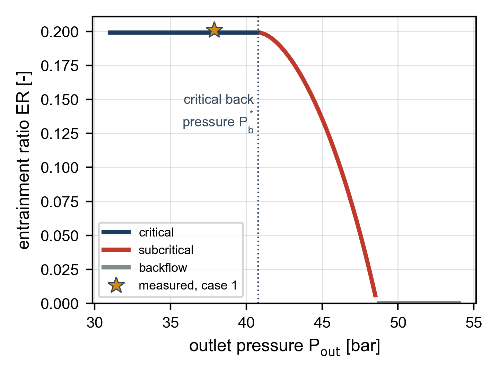

.. _operating_modes:

==================================
Operating Modes: Rating and Design
==================================

The component models of the previous two chapters turn one unknown, the
mixing-inlet pressure :math:`P_\mathrm{y}`, into an outlet state. What is
specified and what is solved for defines three modes:

.. list-table::
   :header-rows: 1
   :widths: 18 40 42

   * - Mode
     - Specified
     - Computed
   * - **Rating**
     - inlet states, geometry :math:`(A_\mathrm{t}, A_\mathrm{e}, A_\mathrm{mix})`, :math:`P_\mathrm{out}`
     - :math:`\dot m_\mathrm{m}`, :math:`\dot m_\mathrm{s}`, ER, regime, :math:`P_\mathrm{y}`, internal states
   * - **Design**
     - inlet states, :math:`\dot m_\mathrm{m}`, ER
     - maximum :math:`P_\mathrm{out}` and the geometry that reaches it
   * - **Design for lift**
     - inlet states, :math:`\dot m_\mathrm{m}`, required :math:`P_\mathrm{out}`
     - the largest ER whose optimum design reaches :math:`P_\mathrm{out}`, and that design

These correspond to the three ways a geometry can be available: **known**
(rating), **proposed** (design, then rate the proposal off-design), or only
**non-dimensional** (design returns area ratios that scale with
:math:`\dot m_\mathrm{m}`; :ref:`sec-scaling`).

.. _sec-rating:

Rating a known geometry
=======================

For a trial :math:`P_\mathrm{y}` the model computes the motive flow
(:ref:`sec-motive-nozzle`), the suction flow (:ref:`sec-suction`), the mixed
state (:ref:`sec-mixing`) and the outlet pressure (:ref:`sec-diffuser`). The
result is a function :math:`P_\mathrm{out}^\mathrm{calc}(P_\mathrm{y})`. Raising
:math:`P_\mathrm{y}` toward :math:`P_\mathrm{s0}` reduces the suction velocity
and flow, and raises the outlet pressure the ejector can deliver. Rating finds
the :math:`P_\mathrm{y}` whose outlet pressure matches the specification.

.. _sec-regimes:

Operating regimes
-----------------

As the back pressure rises, an ejector passes through three regimes
(:numref:`fig-offdesign`, for the R744 ejector of Giacomelli *et al.*
:cite:`giacomelli2019`):

**Critical (on-design, "double-choked").** The entrainment has reached its
maximum and does not respond to :math:`P_\mathrm{out}`. The maximum is set
either by the suction annulus choking (:math:`P_\mathrm{y} = P_\mathrm{y}^*`), or
by the mixed flow choking in the constant-area section, i.e. the lowest
:math:`P_\mathrm{y}` for which the mixing residual still has a root
(:ref:`sec-mixing`). The outlet pressure delivered at this point is the
**critical back pressure** :math:`P_\mathrm{b}^*`. Any specified
:math:`P_\mathrm{out} \le P_\mathrm{b}^*` leaves the flows unchanged; the excess
pressure is dissipated in shocks downstream of the mixing section.

**Subcritical (off-design).** For
:math:`P_\mathrm{out} > P_\mathrm{b}^*` the suction is no longer choked. The
matching :math:`P_\mathrm{y}` is the root of
:math:`P_\mathrm{out}^\mathrm{calc}(P_\mathrm{y}) = P_\mathrm{out}`. The entrainment
falls steeply with back pressure.

**Backflow.** Above the outlet pressure reached at zero entrainment
(:math:`P_\mathrm{y} \to P_\mathrm{s0}`) the suction flow would reverse. The
model reports :math:`\dot m_\mathrm{s} = 0` and the regime. Reverse flow through
the suction port is not modelled.

.. _fig-offdesign:

   Rating characteristic of the Giacomelli *et al.* R744 ejector at the
   inlet states of their case 1 (motive 104.1
   bar, 36.9 °C; suction 30.8 bar), with the calibrated efficiencies. The
   critical plateau (ER 0.199) extends to :math:`P_\mathrm{b}^* = 40.8` bar
   (dotted). Entrainment falls to zero near 48.6 bar; above it the model
   reports backflow (grey, ER = 0). Star: the measurement at 37.9 bar, ER 0.201.
   Data: ``figures/data/offdesign_case1.csv``.

A rating result returns the regime, both mass flows, :math:`P_\mathrm{y}`,
:math:`P_\mathrm{t}`, :math:`P_\mathrm{e}`, :math:`P_3`, the velocities, all
internal states, :math:`\eta_\mathrm{ej}` and the solid margin. Sweeping
:math:`P_\mathrm{out}` gives the off-design map. The algorithm, including how
the critical point is located precisely, is described in
:ref:`sec-rating-algorithm`.

.. _sec-design:

Optimum design
==============

In design mode the geometry is the output. For a trial :math:`P_\mathrm{y}`:

* the motive nozzle is **ideally expanded** to the mixing-inlet pressure,
  :math:`P_\mathrm{e} = P_\mathrm{y}`;
* the throat area passes the motive flow, :math:`A_\mathrm{t} = \dot m_\mathrm{m}/(C_d\,G^*)`
  when choked (or :math:`C_d\,G(P_\mathrm{y})` when not);
* the exit area passes it at :math:`P_\mathrm{y}`,
  :math:`A_\mathrm{e} = \max\bigl(\dot m_\mathrm{m}/(\rho_\mathrm{e}u_\mathrm{e}),\,A_\mathrm{t}\bigr)`;
* the suction annulus passes :math:`\dot m_\mathrm{s} = \mathrm{ER}\,\dot m_\mathrm{m}`
  at :math:`P_\mathrm{y}`, :math:`A_\mathrm{sy} = \dot m_\mathrm{s}/(\rho_\mathrm{y}u_\mathrm{y})`; and
* :math:`A_\mathrm{mix} = A_\mathrm{e} + A_\mathrm{sy}`.

The mixing section and diffuser then give :math:`P_\mathrm{out}(P_\mathrm{y})`.
:math:`P_\mathrm{y}` is chosen to **maximise the outlet pressure**. A low
:math:`P_\mathrm{y}` gives a fast, momentum-rich suction stream but a small
annulus, while a high :math:`P_\mathrm{y}` wastes motive momentum. The optimum
lies in between, generally a little below the suction pressure. The result is
the best ejector of this family for the duty: optimal over :math:`P_\mathrm{y}`,
with the nozzle ideally expanded and :math:`A_\mathrm{mix} = A_\mathrm{e} + A_\mathrm{sy}`.
Exit and mixing areas are not free variables of the optimisation. Rating the designed
geometry at its design outlet pressure recovers the design ER
(:ref:`sec-val-suite`).

Design for a required lift
--------------------------

When the outlet pressure is the specification, the optimum-design outlet
pressure :math:`P_\mathrm{out}^\mathrm{opt}(\mathrm{ER})` is inverted. Over most
of the range it falls with ER (:numref:`fig-duty`). At very small ER it rises
first: the suction annulus is then so small that the constant-area section can
pass the flow only in a narrow band of :math:`P_\mathrm{y}` just below the
suction pressure, and the ER → 0 limit is itself infeasible, because
:math:`\eta_\mathrm{mix}` still removes motive momentum when nothing is
entrained. The largest ER that reaches the requirement is therefore the root of
:math:`P_\mathrm{out}^\mathrm{opt}(\mathrm{ER}) = P_\mathrm{out}` on the falling
branch, beyond the maximum. The duty is infeasible for that motive state and
efficiency set only if the requirement exceeds the maximum, and the model then
says so with the maximum it found (:ref:`sec-solution-design`).

.. _sec-scaling:

Scaling and non-dimensional design
==================================

For fixed inlet states and efficiencies, every area in the design is
proportional to :math:`\dot m_\mathrm{m}`. All pressures, velocities, ER,
:math:`\Pi` and :math:`\eta_\mathrm{ej}` are independent of it. A design is
therefore characterised by its **area ratios** :math:`A_\mathrm{mix}/A_\mathrm{t}`
and :math:`A_\mathrm{e}/A_\mathrm{t}`, and scaling to another capacity scales
all diameters by :math:`\sqrt{\dot m_\mathrm{m}}`. The model is exactly
scale-invariant, because friction and other size effects are lumped into the
efficiencies. Scale-up is therefore safe only within the range of the data
those efficiencies were fitted to (:ref:`worked_example`).

.. _sec-flowsheet-specs:

Specifications inside a flowsheet
=================================

A sequential-modular PME fixes both inlet streams, flows included, before it
calls the unit. The ER is then known on entry, and the **outlet pressure** is
what the unit computes. The unit offers two ways to get it:

* **Design** (the "ideal" ejector). The port flows give :math:`\dot m_\mathrm{m}`
  and ER, and the optimum design (:ref:`sec-design`) returns the highest outlet
  pressure the efficiencies allow, together with the geometry that reaches it.
* **Rating** of a given geometry, by **inverse rating**: the unknown is
  :math:`P_\mathrm{y}`, from :math:`\mathrm{ER}(P_\mathrm{y}) = \dot m_\mathrm{s}/\dot m_\mathrm{m}`
  on the branch between the most-entraining feasible point and zero
  entrainment (:ref:`sec-inverse-rating`). If the port suction flow exceeds
  the critical entrainment, there is no solution and the unit says so. If it
  equals it, the ejector delivers the critical back pressure
  :math:`P_\mathrm{b}^*`, the highest outlet pressure on the critical plateau.

A choked motive nozzle sets its own flow, :math:`C_d G^* A_\mathrm{t}`, which in
general differs from the port motive flow. Rating therefore comes in two
variants:

* **Fixed shape**: the geometry is given as the area ratios
  :math:`A_\mathrm{e}/A_\mathrm{t}` and :math:`A_\mathrm{mix}/A_\mathrm{t}`, and the
  throat is sized to pass the port motive flow. Because the model is
  scale-invariant (:ref:`sec-scaling`), the shape alone fixes
  :math:`\mathrm{ER}(P_\mathrm{y})` and :math:`P_\mathrm{out}(P_\mathrm{y})`. This
  always solves, and is the default.
* **Fixed size**: the diameters are given. The unit still uses the port motive
  flow, solves the same scaled problem, and reports the capacity of the given
  throat and its mismatch with the port flow. The flowsheet closes the
  mismatch, for example with an adjust on the motive pressure, as it would for
  a fixed-size valve.

The parameters of the unit are listed in :ref:`appendix_capeopen`.
