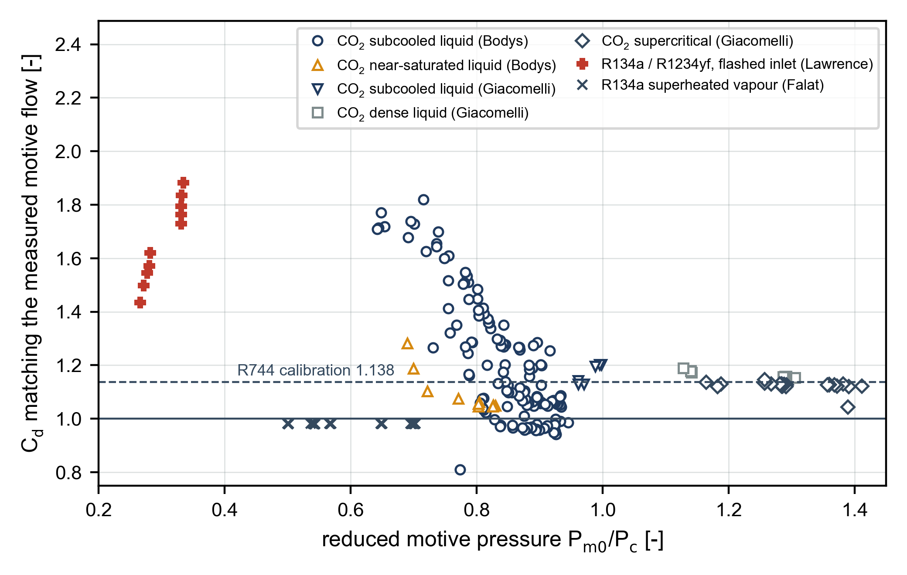
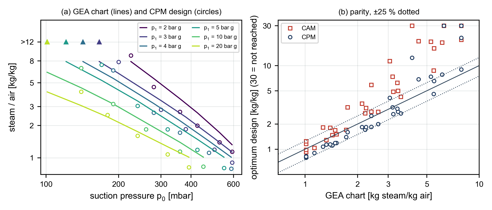

.. _parameter_guide:

====================================
Parameter Guide: Evidence and Choice
====================================

The model has one structural choice, the mixing model (CAM or CPM,
:ref:`mixing_diffuser`), and five loss parameters: :math:`C_d`,
:math:`\eta_\mathrm{m}`, :math:`\eta_\mathrm{s}`, :math:`\eta_\mathrm{mix}` and
:math:`\eta_\mathrm{d}`. CPM adds a sixth, :math:`\varphi_\mathrm{p}`. None of them
is a fluid property. This chapter collects the evidence from every data set
available to this reference: which values reproduce the measurements, how well
a set fitted on one ejector predicts another, and where the model fails. It
ends with recommendations by application (:ref:`sec-guide-recommend`).

Every number here is produced by ``figures/gen_data.py guide``. That section
runs ``prototype/validation_sets.py`` (the data sets as model cases),
``calibrate_sets.py`` (the fits) and ``validate_gea.py`` (manufacturer charts).

How the evidence was produced
=============================

.. list-table:: Evidence base
   :header-rows: 1
   :widths: 22 22 10 46

   * - Set
     - Fluid, motive state
     - Points
     - What is measured and compared
   * - Giacomelli 2019 :cite:`giacomelli2019`
     - CO\ :sub:`2`, supercritical to subcooled liquid
     - 42
     - motive and suction flow at the measured outlet pressure (rating)
   * - Bodys 2020 :cite:`bodys2020`
     - CO\ :sub:`2`, subcooled and near-saturated liquid, 47–70 bar
     - 150
     - motive flow only; the mixing sections are not published
   * - Huang 1999 :cite:`huang1999`
     - R141b, saturated vapour
     - 39
     - critical entrainment ratio and critical back pressure, 11 ejectors
   * - Falat 2018 :cite:`falat2018`
     - R134a, superheated vapour
     - 102
     - motive and suction flow along five back-pressure sweeps (rating)
   * - Shestopalov 2015 :cite:`shestopalov2015a,shestopalov2015b`
     - R245fa, saturated vapour
     - 9
     - critical entrainment ratio and critical condensing temperature, 9 ejectors
   * - Lawrence 2012 :cite:`lawrence2012`
     - R134a and R1234yf, liquid throttled to two-phase
     - 10
     - motive and suction flow at the measured outlet pressure (rating)
   * - GEA catalogue :cite:`gea2018`
     - steam/air, air/air, water/air
     - charts
     - manufacturer design charts, compared with the optimum design (:ref:`sec-guide-gea`)

The data are in ``prototype/data``, each file with its source, pages and
checks in the header. The fits follow the two-stage method of
:ref:`sec-val-giacomelli`:

1. :math:`C_d` is fitted on the measured motive flow, where there is one.
2. Two loss parameters are fitted, with :math:`\eta_\mathrm{m} = 0.90` and
   :math:`\eta_\mathrm{d} = 0.85` fixed. For CAM these are
   :math:`(\eta_\mathrm{s}, \eta_\mathrm{mix})`. For CPM on the vapour sets they
   are :math:`(\varphi_\mathrm{p}, \eta_\mathrm{mix})` with
   :math:`\eta_\mathrm{s} = 0.85`; for CPM on the two-phase sets they are
   :math:`(\eta_\mathrm{s}, \eta_\mathrm{mix})` with :math:`\varphi_\mathrm{p} = 1`.

The parameters are fixed because the data cannot separate them. The lift
depends on :math:`\eta_\mathrm{mix}` and :math:`\eta_\mathrm{d}` jointly: with both
free, :math:`\eta_\mathrm{d}` ran to its lower bound of 0.3 while
:math:`\eta_\mathrm{mix}` rose to compensate. With :math:`\varphi_\mathrm{p} = 1`,
every CPM fit drove :math:`\eta_\mathrm{s}` to its upper bound of 1, because the
entrainment is set by the core-area factor :math:`\varphi_\mathrm{p}`. The value
0.85 for :math:`\eta_\mathrm{d}` is that of the gas-ejector set, inside the
0.75–0.9 range assumed in the literature :cite:`liu2014review`.

.. _sec-guide-cd:

Motive discharge coefficient
============================

:math:`C_d` corrects the homogeneous-equilibrium critical flux
(:ref:`sec-motive-nozzle`). :numref:`fig-guide-cd` shows, for every point with a
measured motive flow, the :math:`C_d` that reproduces that point, against the
reduced motive pressure.

.. _fig-guide-cd:

   :math:`C_d` matching each measured motive flow on the isentropic HEM critical
   flux. Data: ``figures/data/guide_cd.csv``.

* **Vapour and gas.** Falat's superheated R134a needs 0.98 on all 102 points.
  :math:`C_d = 1` is adequate.
* **Supercritical and dense CO**\ :sub:`2` (:math:`P_\mathrm{m0} > P_\mathrm{c}`).
  The Giacomelli points need 1.04–1.19. The fitted 1.138 holds over the whole
  supercritical range.
* **Subcooled liquid.** The required :math:`C_d` rises steeply once the motive
  pressure falls below about 0.85 :math:`P_\mathrm{c}`. On the Bodys data it is
  1.08 (nozzle A) and 1.07 (nozzle B) at 64–67 bar, 1.36 / 1.06 at 56–60 bar, and
  1.59 / 1.46 at 52–56 bar (:numref:`tab-guide-bodys`). Lawrence's R134a and
  R1234yf at :math:`P_\mathrm{r} \approx 0.3` need 1.68 as a set. Liquid that
  stays metastable well below its saturation pressure passes much more flow
  than equilibrium flashing allows, which is the delayed flashing of
  :ref:`sec-hne`. The correction depends on the pressure level more than on the
  subcooling (correlation −0.76 against +0.30, :ref:`sec-val-hne`).
* **Near-saturated liquid** (Bodys, within 0.5 K of saturation) needs only
  1.05–1.28. Vapour is generated at once, close to equilibrium.

.. _tab-guide-bodys:

.. list-table:: Bodys 2020: :math:`C_d` required by the HEM flux, by motive pressure
   :header-rows: 1
   :widths: 22 16 12 25 25

   * - Motive pressure [bar]
     - Nozzle
     - Points
     - Mean :math:`C_d`
     - Range
   * - 45–52
     - B (2.00 mm)
     - 9
     - 1.61
     - 1.19–1.77
   * - 52–56
     - A / B
     - 6 / 6
     - 1.59 / 1.46
     - 1.27–1.82 / 1.10–1.65
   * - 56–60
     - A / B
     - 20 / 9
     - 1.36 / 1.06
     - 1.05–1.55 / 0.81–1.17
   * - 60–64
     - A / B
     - 25 / 8
     - 1.20 / 1.02
     - 1.05–1.37 / 0.97–1.27
   * - 64–67
     - A / B
     - 20 / 23
     - 1.08 / 1.07
     - 1.05–1.20 / 0.96–1.29
   * - 67–71
     - A / B
     - 11 / 13
     - 1.07 / 1.00
     - 1.04–1.25 / 0.94–1.09

The two nozzles differ by up to 0.3 at the same pressure, which shows that
:math:`C_d` also carries nozzle-specific effects. A single :math:`C_d` is
therefore reliable only for supercritical and dense motive states, and for
liquid motive above about 0.85 :math:`P_\mathrm{c}`. Below that, take :math:`C_d`
from a measured flow of the actual nozzle. A flow measurement on the
installation is the cheapest calibration available.

.. _sec-guide-mixing:

Mixing model and efficiencies
=============================

:numref:`tab-guide-fits` compares the two mixing models on each set:

* first with the Screening set (0.90 / 0.85 / 0.90 / 0.80, :math:`C_d = 1`),
  i.e. as a user without data would run it;
* then after the two-parameter fit.

.. _tab-guide-fits:

.. list-table:: Mixing models on each set: Screening prediction and fit (MAE, %). Rating sets: suction flow, scaled by the mean. Critical sets: ER* / lift :math:`P_\mathrm{b}^* - P_\mathrm{s0}`. Data: ``guide_fits.csv``.
   :header-rows: 1
   :widths: 17 7 15 31 15 15

   * - Set
     - Model
     - Screening
     - Fitted parameters (:math:`C_d`)
     - Fitted
     - Note
   * - Giacomelli CO\ :sub:`2`
     - CAM
     - 29.4
     - :math:`\eta_\mathrm{s}` 0.599, :math:`\eta_\mathrm{mix}` 0.819 (1.138)
     - 4.6
     -
   * -
     - CPM
     - 22.7
     - :math:`\eta_\mathrm{s}` 0.665, :math:`\eta_\mathrm{mix}` 0.855 (1.138)
     - 5.1
     - :math:`\varphi_\mathrm{p}` fits to 1
   * - Huang R141b
     - CAM
     - 11.6 / 16.0
     - :math:`\eta_\mathrm{s}` 0.732, :math:`\eta_\mathrm{mix}` 0.985
     - 5.9 / 2.4
     -
   * -
     - CPM
     - 18.2 / 5.7
     - :math:`\varphi_\mathrm{p}` 0.804, :math:`\eta_\mathrm{mix}` 0.945
     - 3.8 / 4.2
     -
   * - Falat R134a
     - CAM
     - 43.0
     - :math:`\eta_\mathrm{s}` 0.561, :math:`\eta_\mathrm{mix}` 1.000 (0.982)
     - 7.8
     - at the bound
   * -
     - CPM
     - 12.8
     - :math:`\varphi_\mathrm{p}` 0.832, :math:`\eta_\mathrm{mix}` 0.887 (0.982)
     - 6.7
     -
   * - Shestopalov R245fa
     - CAM
     - 20.9 / 14.6
     - :math:`\eta_\mathrm{s}` 0.622, :math:`\eta_\mathrm{mix}` 0.983
     - 3.9 / 2.4
     -
   * -
     - CPM
     - 13.1 / 1.6
     - :math:`\varphi_\mathrm{p}` 0.833, :math:`\eta_\mathrm{mix}` 0.920
     - 1.3 / 1.7
     -
   * - Lawrence R134a/R1234yf
     - CAM
     - 100
     - :math:`\eta_\mathrm{s}` 0.611, :math:`\eta_\mathrm{mix}` 0.944 (1.675)
     - 41.3
     - not reproduced
   * -
     - CPM
     - 106
     - :math:`\eta_\mathrm{s}` 0.348, :math:`\eta_\mathrm{mix}` 0.589 (1.675)
     - 34.5
     - not reproduced

Four findings follow.

1. **Without data, CPM predicts better.** With the Screening set, CPM has the
   lower error on Giacomelli, Falat and Shestopalov, and on the Huang lift. The
   exception is the Huang critical entrainment. The largest gain is on Falat's
   R134a ejector, 12.8 % against 43.0 %. Its nozzle exits 29 mm upstream of the
   constant-area section, which is the constant-pressure design.
2. **After fitting, both models reach similar accuracy**, but with different
   parameters. On the three vapour sets, CAM needs :math:`\eta_\mathrm{mix}` of
   0.98–1.00, i.e. no mixing loss at all, to produce the measured lift: the
   constant-area form is short of lift for these ejectors. CPM fits with
   :math:`\varphi_\mathrm{p}` 0.80–0.83 and :math:`\eta_\mathrm{mix}` 0.89–0.95
   on all three rigs and fluids. That is consistent with Huang's own 0.88 and
   0.80–0.84 :cite:`huang1999`.
3. **Two-phase CO**\ :sub:`2` **cannot discriminate.** Giacomelli's ejector
   works at lifts of at most 1.6, where the two models differ little, and both
   fit within 5 %. They part when extrapolated to the higher lift of the worked
   example (:ref:`sec-guide-duty`).
4. **Liquid motive at low reduced pressure is outside the model.** On
   Lawrence's data neither model gets below 34 % even after fitting, and the
   fitted parameters are not physical (CPM :math:`\eta_\mathrm{s}` 0.35). The
   motive flow needs :math:`C_d = 1.68`, and the motive state entering the
   nozzle (two-phase after the throttling upstream) is itself uncertain.

**Transfer between ejectors.** A set is only useful if it predicts ejectors it
was not fitted on. :numref:`tab-guide-transfer` fits the vapour class on two
sets and predicts the third.

.. _tab-guide-transfer:

.. list-table:: Vapour ejectors, fitted on two sets, predicting the third (MAE, %). Data: ``guide_transfer.csv``.
   :header-rows: 1
   :widths: 24 38 38

   * - Predicted set
     - CAM (:math:`\eta_\mathrm{s}`, :math:`\eta_\mathrm{mix}`)
     - CPM (:math:`\varphi_\mathrm{p}`, :math:`\eta_\mathrm{mix}`)
   * - Huang (ER* / lift)
     - 9.9 / 2.1 (0.585, 1.000)
     - 7.8 / 11.5 (0.873, 0.898)
   * - Falat (suction flow)
     - 14.8 (0.672, 0.984)
     - 16.7 (0.818, 0.932)
   * - Shestopalov (ER* / lift)
     - 4.2 / 3.5 (0.626, 1.000)
     - 3.4 / 2.9 (0.876, 0.905)
   * - Fitted on all three
     - 0.622, 1.000
     - 0.869, 0.908

Transferred, the two models are comparable: 3–17 % on entrainment for both.
CPM loses on the Huang lift (−11.5 %, biased low), and CAM again sits at
:math:`\eta_\mathrm{mix} = 1`. The pooled CPM set, :math:`\varphi_\mathrm{p}` 0.869
and :math:`\eta_\mathrm{mix}` 0.908, is the preset ``Vapour_CPM``
(:ref:`sec-guide-recommend`). Its errors on the three sets, fitted on all of
them, are 7.5 / 8.1 % (Huang), 8.3 % (Falat) and 2.8 / 2.2 % (Shestopalov).

.. _sec-guide-gea:

Design charts of a manufacturer
===============================

The GEA catalogue :cite:`gea2018` gives performance charts for ejectors that
are "tailor-made" for "optimum efficiency". These are compared with the
model's optimum design (Design mode, ``design_for_lift`` or ``design``) for the
same duty. The charts were digitised from the catalogue; each worked example
in the catalogue was reproduced to within 1.1 %. Mixed steam/air and water/air
streams use ``prototype/water_air.py``: IAPWS-95 water, CoolProp air, ideal
gas mixing, pure liquid condensate. It agrees with CoolProp's humid-air
routines to 0.02 %.

.. _fig-guide-gea:

   Single-stage steam-jet vacuum pump compressing air at 20 °C to 1013 mbar
   (GEA p. 39, Fig. 1), with the gas-ejector efficiencies. (a) Chart (lines) and
   CPM optimum design (circles); triangles: the design needs more than 12 kg/kg
   or cannot reach 1013 mbar. (b) Parity for both mixing models. Data:
   ``figures/data/guide_gea.csv``.

**Steam/air vacuum pump** (:numref:`fig-guide-gea`). The model has the right
trend in both suction and motive pressure. Its accuracy depends on mixing
model, efficiencies and compression ratio :math:`1013/p_0`:

* **CPM, gas-ejector efficiencies (0.95 / 0.85 / 0.95 / 0.85).** On the 29
  points with compression ratio up to 6, the design needs 11 % less steam than
  the chart on average (MAE 18 %, range −24 to +40 %).
* **Above a compression ratio of 6** (the low-suction end of each curve), the
  model's attainable lift falls short. One of the seven points cannot reach
  1013 mbar at all, and the others need at least 35 % more steam.
* **CAM with the same efficiencies** needs 59 % more steam on average up to a
  compression ratio of 6, with errors up to +266 %.
* **The Screening and Vapour_CPM sets** (:math:`\eta_\mathrm{mix}` about 0.9,
  :math:`\eta_\mathrm{d}` 0.80–0.85) are not adequate for steam: +265 % and
  +64 % on average with CPM.

High-compression steam ejectors therefore need CPM and efficiencies near 0.95.

**Air ventilator** (low lift, :math:`\Delta p \le` 500 mbar, p. 60). The two
mixing models agree within a few per cent, and the efficiency set dominates.
Against the chart, compression is −18 % on average with the Screening set,
+16 to +19 % with the gas-ejector set, and −4 to −8 % with Vapour_CPM
(MAE 13–14 %). One curve label (3 or 5 bar g) is illegible in the catalogue;
both readings are included.

**Water-jet vacuum pump** (water at 20 °C, air from 100 mbar to 1013 mbar,
pump size 2, p. 8). The entrainment ratio of the chart is the product of its two
nomograms: air flow from Fig. 1 and water flow from Fig. 2. The optimum design
entrains 3.1–5.5 times more air than the catalogue pump with CPM, and 8.5–17.7
times more with CAM, whatever the efficiency set. A catalogue pump is not an
optimum design for each point, but the gap is far larger than that. Mixing a
liquid jet with a gas is much more dissipative than a homogeneous momentum
balance with :math:`\eta_\mathrm{mix} \approx 0.9` allows. The model is not
predictive for liquid-jet gas pumps without calibration on the pump itself.

.. _sec-guide-duty:

Consequence for the worked example
==================================

Fitted on the same 42 Giacomelli points and equally good there, the two models
give for the duty of :ref:`worked_example`:

.. list-table:: Duty (13.66 kg/s motive, 2 kg/s saturated vapour at 15 bar) with the R744 fit of each model. Data: ``guide_duty.csv``.
   :header-rows: 1
   :widths: 30 14 28 28

   * - Motive
     - Model
     - :math:`P_\mathrm{out}` at 2 kg/s [bar]
     - suction flow at 28 bar [kg/s]
   * - 84.5 bar, 32 °C
     - CAM
     - 23.95
     - 0.82
   * -
     - CPM
     - 26.27
     - 1.47
   * - 47 bar, saturated liquid
     - CAM
     - 19.70
     - not reached
   * -
     - CPM
     - 20.35
     - not reached

The mixing model moves the 84.5 bar outlet pressure by 2.3 bar. That is more
than the spread of the three CAM R744 sets, and comparable to the
:math:`\eta_\mathrm{m}` sensitivity. Neither model reaches 28 bar at 2 kg/s, so
the conclusion of the worked example stands. The band of possible outcomes is
wider than the CAM results alone suggest, and it reaches closer to the target.

.. _sec-guide-recommend:

Recommendations
===============

.. list-table:: Parameter choice by application. Errors are those found on the evidence above; outside it they are larger.
   :header-rows: 1
   :widths: 22 14 34 30

   * - Application
     - Mixing
     - Parameters (preset)
     - Expected accuracy, cautions
   * - Single-phase vapour ejector (refrigerant, organic vapour); nozzle exit upstream of the constant-area section
     - CPM
     - ``Vapour_CPM``: 0.90 / 0.85 / 0.908 / 0.85, :math:`\varphi_\mathrm{p}` 0.869, :math:`C_d` 1
     - entrainment 3–17 % on an ejector not in the fit; lift within 2–12 %. CAM with fitted efficiencies is as accurate but needs :math:`\eta_\mathrm{mix} \to 1`
   * - Steam (or gas) vacuum ejector, design of a new unit
     - CPM
     - gas-ejector efficiencies 0.95 / 0.85 / 0.95 / 0.85
     - steam consumption within −24 to +40 % up to a compression ratio of about 6; above it the model under-predicts the attainable lift. The Screening set is not adequate for steam
   * - Low-lift gas ejector, ventilator (lift ≤ 1.5)
     - either
     - ``Vapour_CPM`` (closest), gas-ejector or Screening efficiencies
     - the two models agree; the efficiency set moves the result by ±20 %; ``Vapour_CPM`` within −4 % on average (MAE 13 %)
   * - CO\ :sub:`2` with supercritical or dense motive (:math:`P_\mathrm{m0} \gtrsim 0.85\,P_\mathrm{c}`)
     - CAM or CPM
     - R744 sets (CAM, :math:`C_d` 1.138); CPM refit in :numref:`tab-guide-fits`
     - suction flow within 5 % on the fitted ejector (lift ≤ 1.6). At higher lift the two models diverge (2.3 bar in the worked example): report both
   * - Liquid motive below about 0.85 :math:`P_\mathrm{c}` (subcooled)
     - either
     - :math:`C_d` from a measured flow of the actual nozzle
     - the HEM flux is up to 47 % low (:math:`C_d` up to 1.9); one :math:`C_d` does not transfer between nozzles or pressure levels. Near-saturated liquid needs 1.05–1.3
   * - Liquid-jet gas pump (water motive, gas suction)
     - --
     - not recommended without calibration on the pump
     - the optimum design entrains 3–18 times more gas than catalogue pumps; mixing losses of liquid–gas jets are far larger than any set here represents
   * - Liquid–liquid jet pump
     - CAM
     - efficiencies from the pump type; the loss-free model is the classical jet pump
     - reduces exactly to ``fluids.liquid_jet_pump`` (:ref:`sec-val-fluids`)

The CAPE-OPEN unit's default set, ``Screening`` (0.90 / 0.85 / 0.90 / 0.80,
:math:`C_d` 1), runs with CPM because of finding 1 of :ref:`sec-guide-mixing`:
without calibration data CPM is the better first guess. It is not adequate for
high-compression steam ejectors or liquid motive at low reduced pressure (see
the table).

Three general rules follow from the evidence.

* **Calibrate on the ejector, or on its nearest relative.** Fitted sets
  reproduce their own data to 1–8 %. Transferred to another ejector of the same
  class they give 3–17 %; transferred across classes they are not supported.
* **Treat** :math:`\eta_\mathrm{m}` **and** :math:`\eta_\mathrm{d}` **as fixed
  assumptions, not results.** The data cannot separate them from
  :math:`\eta_\mathrm{s}`, :math:`\eta_\mathrm{mix}` and :math:`\varphi_\mathrm{p}`.
  A fitted set is valid only with the values it was fitted with (0.90 and 0.85
  here).
* **When extrapolating, run both mixing models.** Where the data do not
  discriminate, the spread between CAM and CPM is part of the uncertainty.
