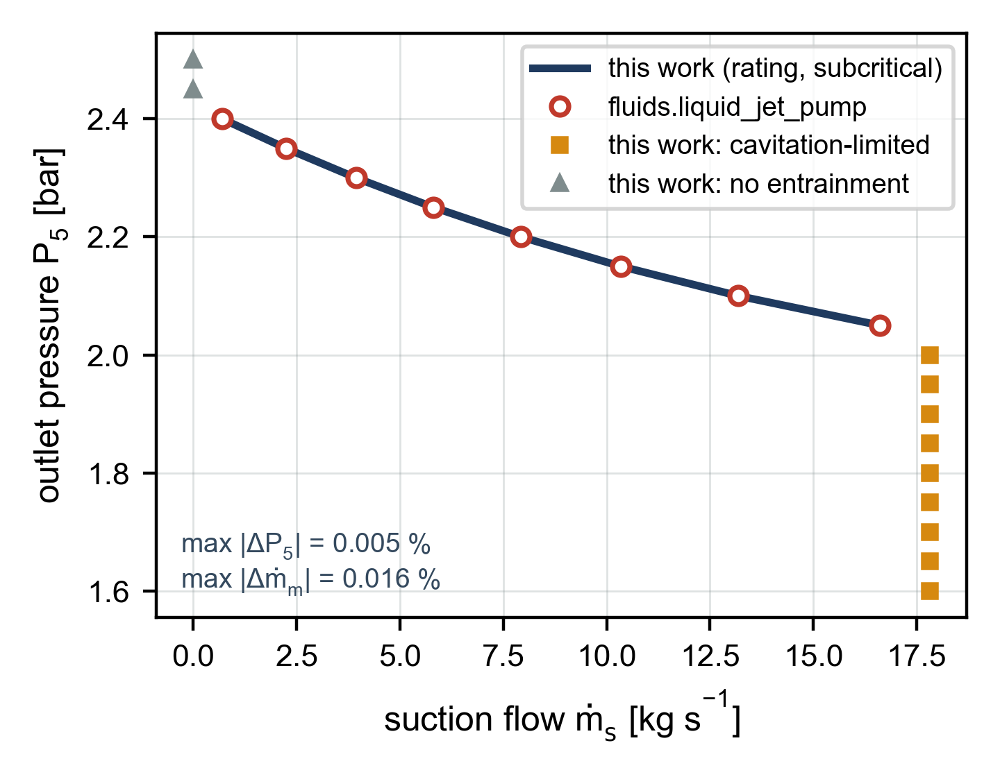
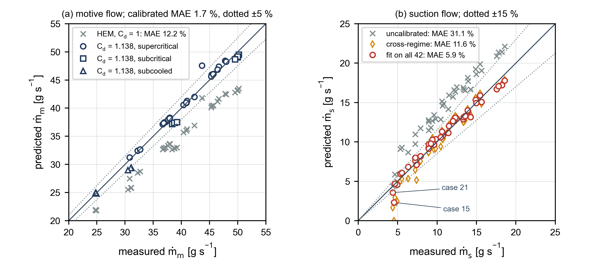
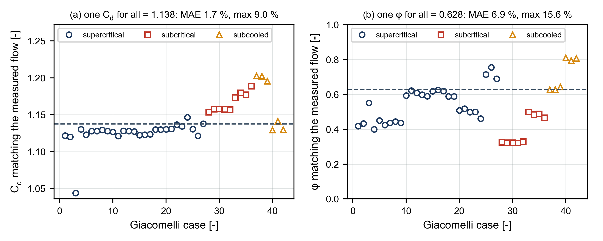

.. _validation:

==========
Validation
==========

The model is checked at four levels:

* an automated **test suite**;
* **verification** against exact limits, namely the classical incompressible jet
  pump and the ideal-gas critical-pressure ratio;
* **prediction** of two published experimental data sets with literature
  efficiencies; and
* a **calibration** on 42 measured R744 points, with a cross-regime check of how
  well the fitted efficiencies transfer.

Every "this work" number and figure in this chapter comes from
``figures/gen_data.py``, which runs the reference implementation and writes
the CSVs in ``figures/data/``. The ``make_*.py`` scripts plot those CSVs. No
model result is hand-entered.

.. _sec-val-suite:

Automated test suite
====================

25 tests run with ``python -m pytest`` in ``ejector/prototype``:

.. list-table::
   :header-rows: 1
   :widths: 42 8 50

   * - Test
     - Cases
     - Checks
   * - incompressible limit vs ``fluids.liquid_jet_pump``
     - 4
     - :math:`P_5` and motive flow of a loss-free water jet pump (:ref:`sec-val-fluids`)
   * - liquid suction cavitation limit
     - 1
     - water suction at 20 °C is limited at :math:`P_\mathrm{y} = P_\mathrm{sat}` = 2.34 kPa (regime "critical")
   * - ideal-gas critical pressure ratio
     - 1
     - isentropic N\ :sub:`2`: :math:`P^*/P_0 = 0.528 \pm 0.002` (:ref:`sec-val-ideal-gas`)
   * - Huang 1999 regression
     - 1
     - 39 R141b points: :math:`T_\mathrm{sat}(P_\mathrm{b}^*)` MAE < 1.2 K, ER MAE < 18 % (:ref:`sec-val-huang`)
   * - CO\ :sub:`2` design: conservation, solid margin, round trip
     - 1
     - exact energy balance :math:`h_\mathrm{out} = h_{0\mathrm{t}}`; :math:`\sigma > 2`; rating the designed geometry at its design :math:`P_\mathrm{out}` returns the design ER within 2 %
   * - triple-point guard
     - 1
     - a CO\ :sub:`2` flash below 5.18 bar raises ``SolidPhaseRisk``
   * - Gonçalves 2024 motive flow
     - 1
     - three subcooled-liquid CO\ :sub:`2` runs over-predicted by 0–7.5 % with :math:`C_d = 1` (:ref:`sec-val-goncalves`)
   * - mixture composition bookkeeping
     - 1
     - :eq:`eq-mix-composition` for CO\ :sub:`2` + N\ :sub:`2` to :math:`10^{-12}`
   * - Giacomelli 2019 motive :math:`C_d`
     - 1
     - 42 points: fitted :math:`C_d \in (1.10, 1.18)`, motive-flow MAE < 3 % (:ref:`sec-val-giacomelli`)
   * - critical ER independent of scan resolution
     - 1
     - Giacomelli case 1, ``n_scan`` = 10, 25, 80 give the same critical ER to :math:`10^{-4}` (:ref:`sec-rating-algorithm`)
   * - loss-free throat
     - 1
     - :math:`G^*` independent of :math:`\eta_\mathrm{m}`; the path is continuous at the throat and lossy only beyond it
   * - inverse rating
     - 5
     - ``rate_flows`` returns the outlet pressure and throat of a forward rating (critical, subcritical, unchoked water jet pump); zero entrainment; excess suction raises
   * - converging–diverging nozzle regimes
     - 2
     - motive flow continuous at :math:`P_\mathrm{t}` and :math:`P_\mathrm{fc}`, exit continuity in every regime; a forward rating meets the specified :math:`P_\mathrm{out}` or raises (:ref:`sec-unchoked-motive`)
   * - exit area below :math:`C_d`
     - 1
     - :math:`1 < A_\mathrm{e}/A_\mathrm{t} < C_d` raises instead of clamping
   * - design at small ER, design for lift
     - 1
     - ER = 0.005 is feasible and above 32 bar; design for 32 bar finds the root beyond the maximum (:ref:`sec-solution-design`)
   * - critical and backflow results
     - 1
     - outlet state and :math:`\eta_\mathrm{ej}` at the specified :math:`P_\mathrm{out}`; backflow outlet equals the motive stream
   * - triple-point floor
     - 1
     - a design whose suction expansion reaches the triple point raises ``SolidPhaseRisk``

.. _sec-val-fluids:

Incompressible limit: the classical jet pump
=============================================

For an incompressible liquid with all efficiencies set to one, the constant-area
model must reduce to the classical liquid jet-pump equations. These are
implemented, with loss coefficients, in ``fluids.jet_pump.liquid_jet_pump``
:cite:`fluids`. The test case is a water jet pump with 5 bar motive, 1 bar
suction, both at 20 °C, a 20 mm nozzle and a 45 mm mixing tube, and all loss
coefficients :math:`K = 0`. Each rating result :math:`(\dot m_\mathrm{s}, P_\mathrm{out})`
of this model is passed to ``fluids`` as the suction flow, and ``fluids``
returns the outlet pressure and motive flow.

.. _fig-val-fluids:

   Loss-free water jet pump: this model (line) against ``fluids.liquid_jet_pump``
   (circles) over the subcritical range. Below 2.05 bar the suction is
   cavitation-limited, and above 2.4 bar there is no entrainment. Data:
   ``figures/data/fluids_limit.csv``.

Over the subcritical range (outlet 2.05–2.40 bar) the two agree to
:math:`5\times10^{-5}` in outlet pressure and :math:`1.6\times10^{-4}` in motive
flow (:numref:`fig-val-fluids`). This verifies the momentum and energy balances
and the unchoked motive treatment :eq:`eq-motive-unchoked`. Below 2.05 bar the
model correctly switches to the cavitation-limited regime, which the
incompressible equations do not represent.

.. _sec-val-ideal-gas:

Ideal-gas critical flow
=======================

Isentropic expansion of nitrogen from 10 bar and 300 K should choke at
:math:`P^*/P_0 = (2/(k+1))^{k/(k-1)} = 0.5283`. The choke search returns 0.5270. The
real-fluid path coincides with the analytic ideal-gas flux curve
(:numref:`fig-nozzle-flux` a). The 0.2 % difference is within the real-gas
deviation of nitrogen at 10 bar and the search tolerance.

.. _sec-val-huang:

Gas ejector: Huang et al. (1999), R141b
=======================================

Huang *et al.* :cite:`huang1999` measured 39 critical-mode operating points on
R141b ejectors: 11 geometries, motive 4.0–6.0 bar and suction 0.40–0.47 bar,
both saturated vapour. They report the critical entrainment ratio and the
critical back pressure. The data and geometry used here are those tabulated by
Ma *et al.* :cite:`ma2017` (Table 1). The model is run without fitting, with
the efficiency values :math:`0.95, 0.85, 0.95, 0.85` that Ma *et al.* used.
Their model is a constant-pressure (hypothetical-throat) model that applies
:math:`\eta_\mathrm{n}` in both nozzle sections. They used the measured ER to
obtain the hypothetical throat area, so these values were never used there
to predict ER, and they do not have the same role as here. Rating each geometry
at a low back pressure returns the critical ER and :math:`P_\mathrm{b}^*`.

**What this tests.** All 39 points are suction-choked
(:math:`P_\mathrm{y} = P_\mathrm{y}^*`). The critical ER then depends on the
suction choke in the annulus and on :math:`\eta_\mathrm{s}` only; changing
:math:`\eta_\mathrm{m}`, :math:`\eta_\mathrm{mix}` or :math:`\eta_\mathrm{d}`
leaves it unchanged. :math:`P_\mathrm{b}^*` tests :math:`\eta_\mathrm{m}`,
:math:`\eta_\mathrm{mix}` and :math:`\eta_\mathrm{d}` at that imposed ER. The
comparison is a check of the suction-choke assumption and of the
mixing-diffuser chain in critical mode. Off-design (subcritical) behaviour of
gas ejectors is not tested.

.. _fig-val-huang:

.. figure:: figures/val_huang.png
   :width: 100%
   :align: center

   Huang *et al.* R141b data, 39 points. Left: critical entrainment ratio.
   Right: critical back pressure, expressed as saturation temperature. Navy:
   Ma's efficiency set. Red: :math:`\eta_\mathrm{s} = 0.70`. Data:
   ``figures/data/huang1999.csv``.

.. list-table:: Huang 1999: prediction statistics
   :header-rows: 1
   :widths: 34 22 22 22

   * - Efficiency set
     - ER bias / MAE / max
     - :math:`T_\mathrm{sat}(P_\mathrm{b}^*)` bias / MAE
     - Comment
   * - 0.95/0.85/0.95/0.85 (Ma)
     - +11.2 / 11.6 / 28.9 %
     - −0.22 / 0.47 K
     - fully predictive
   * - 0.95/**0.70**/0.95/0.85
     - +0.2 / 5.6 / 17.1 %
     - −0.68 / 0.72 K
     - :math:`\eta_\mathrm{s}` adjusted

The critical back pressure is predicted to within 0.5 K of saturation
temperature on average (2 K at most), i.e. a few percent in pressure, without
any fitting. Entrainment is over-predicted by 11 %. Lowering
:math:`\eta_\mathrm{s}` to 0.70 removes the bias but costs 0.25 K in
:math:`P_\mathrm{b}^*`. Both targets come from the same operating points, so
this tension points to the model structure (the suction choke in the annulus)
rather than to an operating-point dependence of the efficiencies.

.. _sec-val-goncalves:

Subcooled liquid CO\ :sub:`2` motive: Gonçalves et al. (2024)
=============================================================

Gonçalves *et al.* :cite:`goncalves2024` ran a CO\ :sub:`2` ejector with
subcooled liquid motive at 34.5–34.8 bar. The geometry is taken from their
dimensioned drawing (Fig. 5): throat 1.5 mm, exit 1.9 mm, mixing section 4 mm.
The authors found the measured motive temperature to be inconsistent with the
measured density. They used the state implied by :math:`(P, \rho)` in their CFD
instead, about 9 K colder. This model is run both ways with
:math:`\eta = 0.90, 0.85, 0.90, 0.80`.

.. list-table:: Gonçalves 2024: motive flow and entrainment. Source: ``figures/data/goncalves2024.csv``.
   :header-rows: 1
   :widths: 10 18 18 18 18 18

   * - Run
     - :math:`\dot m_\mathrm{m}` exp. [g/s]
     - this work, :math:`(P,\rho)` inlet
     - this work, :math:`(P,T)` inlet
     - ER exp.
     - ER this work, :math:`(P,\rho)`
   * - 1
     - 71.1
     - 75.9 (+6.8 %)
     - 43.7 (−38.6 %)
     - 0.007
     - 0.114
   * - 2
     - 70.8
     - 74.9 (+5.8 %)
     - 43.4 (−38.8 %)
     - 0.006
     - 0.122
   * - 3
     - 74.0
     - 76.5 (+3.3 %)
     - 43.9 (−40.7 %)
     - 0.017
     - 0.158

With the consistent inlet state the isentropic HEM throat over-predicts the
motive flow by 3–7 %. The authors' HEM CFD under-predicted it by 1.5–5.7 %, so
the two agree in size but not in sign. This 1.5 mm nozzle would need
:math:`C_d \approx 0.95`, against 1.14 for the 0.9 mm Giacomelli nozzle
(:ref:`sec-val-giacomelli`). With the R744 calibrated set (:math:`C_d = 1.138`)
the motive flow is over-predicted by 18–21 %. The data cannot settle whether
:math:`C_d` transfers between nozzles. The predicted flow changes by about
4.6 % per kelvin of inlet temperature, so the gap between 0.95 and 1.14
corresponds to only about 3.5 K of inlet-state uncertainty, and the authors
report a 9 K inconsistency. The calibrated set has therefore **not been
validated independently** of the nozzle it was fitted on. The **inlet-state
sensitivity** is the key lesson. A 9 K difference in the temperature of a
subcooled liquid changes the predicted flow by about 40 %, because the
saturation pressure, and with it the choke, moves. With the measured
temperature the model even predicts backflow for all three runs.

Entrainment is over-predicted (0.11–0.16 against 0.006–0.017), as it was by the
authors' HEM CFD (about 0.16). These points sit near the zero-entrainment edge
of the characteristic: lowering :math:`\eta_\mathrm{mix}` from 0.90 to 0.80
cuts the predicted ER to 0.04–0.09 (``figures/data/goncalves2024.csv``), so
they test ER only weakly.

.. _sec-val-giacomelli:

Calibration: Giacomelli et al. (2019), R744
===========================================

Giacomelli *et al.* :cite:`giacomelli2019` report 42 operating points of one
fully specified R744 ejector. Throat 0.90 mm, exit 1.03 mm, mixing section
2.0 × 16.9 mm, diffuser 5° to 10 mm. The motive ranges from supercritical
(85.9–104.1 bar, 27 points) through subcritical (83–96 bar, 9 points) to
subcooled (71–74 bar, 6 points), with suction 23.9–39.4 bar. The outlet
pressure is the diffuser-end tap. The table values (``data/giacomelli2019.csv``)
were transcribed from the open accepted manuscript, and every row satisfies
:math:`\mathrm{ER} = \dot m_\mathrm{s}/\dot m_\mathrm{m}`. The Ringstad *et al.*
compilation :cite:`ringstad2020` of the same and other SINTEF data was **not**
used: it gives no geometry and has transcription defects (:ref:`data_library`).

The calibration has two stages, because the motive flow does not depend on the
suction side once the nozzle is choked:

#. **Motive** :math:`C_d` by linear least squares of measured on HEM-predicted
   motive flow. The critical flux is taken on the isentrope
   (:eq:`eq-motive-path`), so this stage does not depend on
   :math:`\eta_\mathrm{m}`.
#. **Suction** :math:`(\eta_\mathrm{s}, \eta_\mathrm{mix}, \eta_\mathrm{d})` by
   nonlinear least squares on the suction mass flow, rating each point at its
   measured outlet pressure, with :math:`\eta_\mathrm{m} = 0.90` fixed.

As a **cross-regime check**, stage 2 is refitted on the 27 supercritical
points and used to predict the 15 subcritical and subcooled ones, and the
other way round.

.. _fig-val-giacomelli:

   Giacomelli *et al.* R744 ejector, 42 points. (a) Motive flow: uncalibrated
   HEM (crosses), and with :math:`C_d = 1.138` by inlet regime. (b) Suction
   flow: uncalibrated, fitted on all points (0.61 / 0.83 / 0.82), and the
   cross-regime prediction. Data: ``figures/data/giacomelli_sim.csv``.

.. list-table:: Fitted parameters (:math:`\eta_\mathrm{m} = 0.90`, :math:`C_d = 1.138`), with standard errors and correlations from the Gauss–Newton covariance at the optimum. Source: ``figures/data/giacomelli_fit.csv``.
   :header-rows: 1
   :widths: 22 7 15 15 15 26

   * - Fit set
     - n
     - :math:`\eta_\mathrm{s}`
     - :math:`\eta_\mathrm{mix}`
     - :math:`\eta_\mathrm{d}`
     - correlations (s–mix, s–d, mix–d)
   * - all points
     - 42
     - 0.610 ± 0.036
     - 0.825 ± 0.012
     - 0.820 ± 0.032
     - −0.54, −0.14, −0.66
   * - supercritical
     - 27
     - 0.638 ± 0.054
     - 0.829 ± 0.015
     - 0.814 ± 0.040
     - −0.63, +0.14, −0.77
   * - subcritical + subcooled
     - 15
     - 0.872 ± 0.117
     - 0.767 ± 0.014
     - 0.790 ± 0.033
     - −0.71, −0.53, −0.17

.. list-table:: Calibration statistics
   :header-rows: 1
   :widths: 46 54

   * - Quantity
     - Result
   * - motive flow, isentropic HEM throat, :math:`C_d = 1`
     - MAE 12.2 % (HEM under-predicts)
   * - motive flow, :math:`C_d = 1.138`
     - MAE 1.7 %; bias +1.1 / −2.5 / −2.4 % (supercritical / subcritical / subcooled)
   * - suction flow, uncalibrated (0.90/0.85/0.90/0.80)
     - MAE 31.1 %
   * - suction flow, fitted on all 42
     - MAE 5.9 % (bias +0.2 %); ER MAE 0.017, max 0.061
   * - by inlet regime (all-point fit)
     - supercritical 6.7 %, subcritical 4.5 %, subcooled 4.1 %
   * - cross-regime: supercritical fit → subcritical/subcooled
     - MAE 5.6 %
   * - cross-regime: subcritical/subcooled fit → supercritical
     - MAE 14.9 %
   * - regimes at the measured outlet pressure
     - 15 critical, 27 subcritical

Three findings matter for using the model:

* **One discharge coefficient fits all motive regimes.** :math:`C_d = 1.138`
  brings supercritical, subcritical and subcooled inlets alike to within
  ±2.5 % bias. The 12 % under-prediction by the isentropic HEM throat is
  therefore systematic, not regime noise. The motive flows alone cannot say
  what causes it (:ref:`sec-val-hne`).
* **The suction-side efficiencies are only partly identifiable.**
  :math:`\eta_\mathrm{mix}` is well determined (±0.012). :math:`\eta_\mathrm{s}`
  and :math:`\eta_\mathrm{d}` are less so, and are correlated with
  :math:`\eta_\mathrm{mix}` (correlation down to −0.66). The standard errors
  and correlations in the table are the measure of how well the 42 points
  identify them.
* **The efficiencies are not constant over the tested range, but regime and
  lift are confounded.** The subcritical and subcooled set has
  :math:`\eta_\mathrm{mix} = 0.77` against 0.83 for the supercritical set; the
  difference is three standard errors (:math:`z = 3.0`). A set fitted on the
  subcritical and subcooled points predicts the supercritical ones with
  14.9 % MAE. But the subcritical and subcooled points span lifts of only
  1.04–1.22, against 1.06–1.60 for the supercritical ones. On the 11
  supercritical points within that lift range the same prediction has 4.6 %
  MAE. The large error is therefore mostly an extrapolation in lift. Constant
  efficiencies remain the model's main extrapolation risk. The spread between
  the three fitted sets is the minimum uncertainty to carry outside the data
  (:ref:`worked_example`).

The two worst points, cases 15 (−49 %) and 21 (−19 %), have the lowest suction
pressure in the set (24 bar) and the highest lift (about 1.6). Both are
under-predicted, and over the 27 subcritical-regime points the residual
correlates with lift (:math:`r = -0.43`): the model under-predicts entrainment
as lift rises. This is the corner of the data closest to the worked example, so
extrapolating there biases the duty verdict towards "no". All other points are
within ±12 %.

The rating characteristic of this ejector at case-1 conditions is shown in
:numref:`fig-offdesign`. The calibrated model places the measurement (37.9 bar,
ER 0.201) on the critical plateau (ER 0.199), about 3 bar below the predicted
critical back pressure (40.8 bar).

.. _sec-val-hne:

Delayed flashing or discharge coefficient?
------------------------------------------

The :math:`C_d` of stage 1 lumps together every reason why the motive flow
exceeds the isentropic HEM value. If delayed flashing were the main reason, the
HNE correction :eq:`eq-hne` with a single :math:`\varphi` should fit the motive
flows as well as a single :math:`C_d` does. :numref:`fig-val-hne` shows the
:math:`C_d` and the :math:`\varphi` that each point needs on its own, and
:numref:`tab-val-hne` the result of fitting one value of each to all 42 points.

.. _fig-val-hne:

   Correction that reproduces each measured motive flow of the Giacomelli
   *et al.* ejector on its own: (a) discharge coefficient on the isentropic
   HEM flux, (b) HNE flashing factor. Dashed: the single value fitted to all
   42 points. Data: ``figures/data/giacomelli_hne.csv``.

.. _tab-val-hne:

.. list-table:: One correction for all 42 motive flows. Source: ``figures/data/giacomelli_hne_summary.csv``.
   :header-rows: 1
   :widths: 22 14 14 14 36

   * - Correction
     - Value
     - MAE
     - Max
     - Bias: supercritical / subcritical / subcooled
   * - :math:`C_d`
     - 1.138
     - 1.7 %
     - 9.0 %
     - +1.1 / −2.5 / −2.4 %
   * - :math:`\varphi`
     - 0.628
     - 6.9 %
     - 15.6 %
     - −4.0 / −11.3 / +7.7 %

* **A constant** :math:`C_d` **describes the data; a constant**
  :math:`\varphi` **does not.** This holds for the heuristic HNE of
  :eq:`eq-hne` and also for a momentum-consistent one (:ref:`sec-hne`). The :math:`C_d` each point needs is 1.13 on
  average for the supercritical motive and 1.17 for the subcritical and
  subcooled motive. The :math:`\varphi` it needs ranges from 0.32 to 0.81 and
  changes systematically with the inlet regime: 0.32–0.50 subcritical,
  0.40–0.76 supercritical, 0.63–0.81 subcooled.
* **Part of the correction has the signature of delayed flashing.** The
  liquid-like motive needs about 4 % more than the supercritical one. (The
  labels are Giacomelli *et al.*'s: "subcritical" points lie above the critical
  pressure but below the critical temperature, at 83–96 bar; "subcooled" points
  lie just below the critical pressure, at 71–74 bar.) Equilibrium models are
  known to lose accuracy as the expansion crosses the saturation line further
  from the critical point. HEM CFD of other R744 ejectors averaged 5.5 %
  motive-flow error above the critical pressure and 30.5 % below 59 bar
  :cite:`ringstad2020`. Those classes are by pressure, and no calibration point
  lies below 70.9 bar, so the comparison is only qualitative.
* **Most of it does not.** The near-critical supercritical expansions, where
  metastability should be weakest, still need about 12 %. Non-equilibrium does matter
  in this 0.9 mm nozzle: the review :cite:`ringstad2020` reports that
  Giacomelli *et al.*'s non-equilibrium mixture model reproduced its motive flow
  to about 1 % above the critical pressure, and that the model's evaporation
  coefficient had a strong effect on the mass flow. But the motive flows cannot
  separate this from the throat diameter as built: :math:`C_d = 1.138`
  corresponds to a 0.96 mm instead of a 0.90 mm throat.

:math:`C_d` is therefore the recommended correction. HNE is kept for
sensitivity studies. A physical relaxation model would need the nozzle length
profile, which a model of stations does not have.

.. _sec-val-port:

Verification of the C# implementation
=====================================

The CAPE-OPEN unit computes with ``EjectorCore``, a C# port of the Python
reference implementation. The root finder and the bounded minimiser are ports
of the SciPy routines the Python code uses, so both implementations take the
same steps. Three test layers check the port.

**C# against Python on identical thermodynamics.** The C# tests call the same
CoolProp build (8.0.1) through its C interface. Twenty-two reference cases are
exported from the Python model (``ejector/prototype/export_regression.py``):

* rating of the Giacomelli ejector in the critical, subcritical and backflow
  regimes;
* inverse rating with a fixed size, and at zero entrainment with a
  re-sampled operating curve;
* optimum designs for the worked example with HEM and HNE motive models, and a
  design for lift;
* the water jet pump, unchoked and cavitation-limited;
* an R141b gas ejector;
* the paths found by an adversarial review: a converging–diverging nitrogen
  nozzle in all three back-pressure ranges (:ref:`sec-unchoked-motive`) and
  its inverse rating; a small-ER design and a design for lift beyond the
  maximum; and three cases that must fail (an outlet pressure inside a
  characteristic step, an exit area below :math:`C_d`, a solution on the
  triple-point floor), where the C# engine must raise the same error.

All 411 compared quantities agree with **zero difference**. They cover
pressures, flows, areas, velocities, outlet enthalpy, ER, ejector efficiency,
critical ER and back pressure, and every operating-curve point.

**Engine checks on an ideal gas.** These run without CoolProp. The critical
pressure ratio comes out within :math:`10^{-4}` of 0.5283, and the critical
flux within :math:`10^{-8}` of the analytic value, with
:math:`\eta_\mathrm{m} = 0.7`; this confirms that :math:`\eta_\mathrm{m}` does
not act on the throat. The other checks cover the outlet energy balance, the
design–rating round trip, and inverse against forward rating. They also cover
scale invariance (twice the motive flow gives the same outlet pressure and
twice the throat area), the fixed-size mismatch, the design optimum and design
for lift.

**The unit, headless.** A mock material object performs real flashes
(CoolProp or ideal gas) and reports phases and molar properties as a PME
would. Through it, the unit reproduces the engine run directly on CoolProp:

* **Duty design.** The worked-example design with saturated inlets reaches
  21.17813 bar, the Python value. The unit's inlets are TP-flashed at
  saturation and corrected to the saturated end points.
* **Fixed size.** The fixed-size rating of Giacomelli case 1 at the flows of a
  forward rating at 44 bar returns 44 bar. With a 10 % higher port motive flow
  it reports a mismatch of :math:`-0.0909`.
* **No PS flash.** A package that refuses PS flashes gives, by temperature
  search, the same 23.98053 bar as the engine.
* **Excess suction.** An excess suction flow raises an error that names the
  critical ER.

Persistence and the input/output switching of the parameters are also tested.
The unit has **not yet been run inside a PME** (COFE, DWSIM).

Coverage and gaps
=================

.. list-table::
   :header-rows: 1
   :widths: 40 60

   * - Duty
     - Status
   * - liquid–liquid jet pump
     - verified against the classical equations (loss-free); no experimental data yet
   * - gas–gas ejector
     - critical mode only, 39 points R141b: suction-choke ER and :math:`P_\mathrm{b}^*` at imposed ER
   * - flashing / supercritical CO\ :sub:`2` motive, CO\ :sub:`2` vapour suction
     - calibrated (42 points, one 0.9 mm nozzle); motive flow of a second nozzle consistent within inlet-state uncertainty with :math:`C_d = 1` (3 points); calibrated set not independently validated
   * - liquid motive, non-condensable gas suction
     - **not validated**: Cunningham :cite:`cunningham1974` is the candidate data set
   * - mixtures
     - composition bookkeeping verified; **no mixture data**
   * - CO\ :sub:`2` suction below 24 bar, lift above 1.6, large ejectors
     - **outside all data used** (:ref:`worked_example`)
