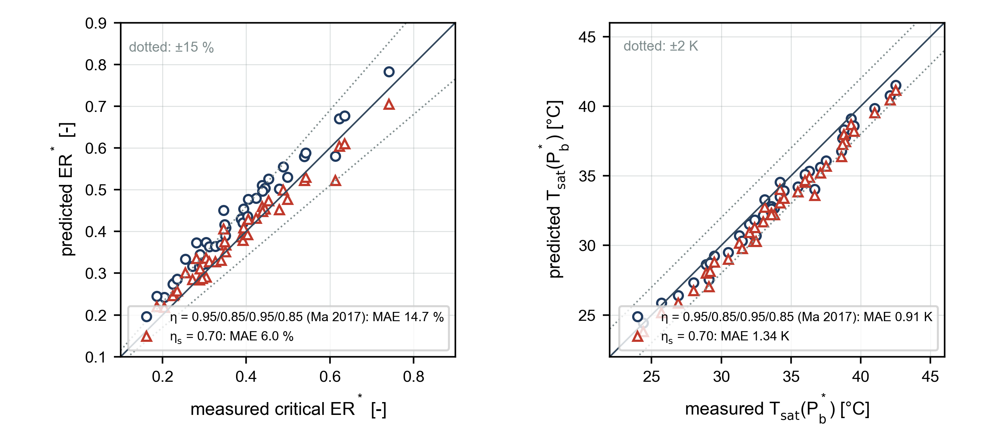

.. _validation:

==========
Validation
==========

The model is checked at four levels:

* an automated **test suite**;
* **verification** against exact limits, namely the classical incompressible jet
  pump and the ideal-gas critical-pressure ratio;
* **prediction** of two published experimental data sets with literature
  efficiencies; and
* a **calibration** on 42 measured R744 points, with a cross-regime check of how
  well the fitted efficiencies transfer.

Every "this work" number and figure in this chapter comes from
``figures/gen_data.py``, which runs the reference implementation and writes
the CSVs in ``figures/data/``. The ``make_*.py`` scripts plot those CSVs. No
model result is hand-entered.

.. _sec-val-suite:

Automated test suite
====================

13 tests run with ``python -m pytest`` in ``ejector/prototype``:

.. list-table::
   :header-rows: 1
   :widths: 42 8 50

   * - Test
     - Cases
     - Checks
   * - incompressible limit vs ``fluids.liquid_jet_pump``
     - 4
     - :math:`P_5` and motive flow of a loss-free water jet pump (:ref:`sec-val-fluids`)
   * - liquid suction cavitation limit
     - 1
     - water suction at 20 °C is limited at :math:`P_\mathrm{y} = P_\mathrm{sat}` = 2.34 kPa (regime "critical")
   * - ideal-gas critical pressure ratio
     - 1
     - isentropic N\ :sub:`2`: :math:`P^*/P_0 = 0.528 \pm 0.002` (:ref:`sec-val-ideal-gas`)
   * - Huang 1999 regression
     - 1
     - 39 R141b points: :math:`T_\mathrm{sat}(P_\mathrm{b}^*)` MAE < 1.2 K, ER MAE < 18 % (:ref:`sec-val-huang`)
   * - CO\ :sub:`2` design: conservation, solid margin, round trip
     - 1
     - exact energy balance :math:`h_\mathrm{out} = h_{0\mathrm{t}}`; :math:`\sigma > 2`; rating the designed geometry at its design :math:`P_\mathrm{out}` returns the design ER within 2 %
   * - triple-point guard
     - 1
     - a CO\ :sub:`2` flash below 5.18 bar raises ``SolidPhaseRisk``
   * - Gonçalves 2024 motive flow
     - 1
     - three subcooled-liquid CO\ :sub:`2` runs within 5 % (:ref:`sec-val-goncalves`)
   * - mixture composition bookkeeping
     - 1
     - :eq:`eq-mix-composition` for CO\ :sub:`2` + N\ :sub:`2` to :math:`10^{-12}`
   * - Giacomelli 2019 motive :math:`C_d`
     - 1
     - 42 points: fitted :math:`C_d \in (1.15, 1.25)`, motive-flow MAE < 3 % (:ref:`sec-val-giacomelli`)
   * - critical ER independent of scan resolution
     - 1
     - Giacomelli case 1, ``n_scan`` = 10, 25, 80 give the same critical ER to :math:`10^{-4}` (:ref:`sec-rating-algorithm`)

.. _sec-val-fluids:

Incompressible limit: the classical jet pump
=============================================

For an incompressible liquid with all efficiencies set to one, the constant-area
model must reduce to the classical liquid jet-pump equations. These are
implemented, with loss coefficients, in ``fluids.jet_pump.liquid_jet_pump``
:cite:`fluids`. The test case is a water jet pump with 5 bar motive, 1 bar
suction, both at 20 °C, a 20 mm nozzle and a 45 mm mixing tube, and all loss
coefficients :math:`K = 0`. Each rating result :math:`(\dot m_\mathrm{s}, P_\mathrm{out})`
of this model is passed to ``fluids`` as the suction flow, and ``fluids``
returns the outlet pressure and motive flow.

.. _fig-val-fluids:

.. figure:: figures/val_fluids.png
   :width: 60%
   :align: center

   Loss-free water jet pump: this model (line) against ``fluids.liquid_jet_pump``
   (circles) over the subcritical range. Below 2.05 bar the suction is
   cavitation-limited, and above 2.4 bar there is no entrainment. Data:
   ``figures/data/fluids_limit.csv``.

Over the subcritical range (outlet 2.05–2.40 bar) the two agree to
:math:`5\times10^{-5}` in outlet pressure and :math:`1.6\times10^{-4}` in motive
flow (:numref:`fig-val-fluids`). This verifies the momentum and energy balances
and the unchoked motive treatment :eq:`eq-motive-unchoked`. Below 2.05 bar the
model correctly switches to the cavitation-limited regime, which the
incompressible equations do not represent.

.. _sec-val-ideal-gas:

Ideal-gas critical flow
=======================

Isentropic expansion of nitrogen from 10 bar and 300 K should choke at
:math:`P^*/P_0 = (2/(k+1))^{k/(k-1)} = 0.5283`. The choke search returns 0.5270. The
real-fluid path coincides with the analytic ideal-gas flux curve
(:numref:`fig-nozzle-flux` a). The 0.2 % difference is within the real-gas
deviation of nitrogen at 10 bar and the search tolerance.

.. _sec-val-huang:

Gas ejector: Huang et al. (1999), R141b
=======================================

Huang *et al.* :cite:`huang1999` measured 39 critical-mode operating points on
R141b ejectors: 11 geometries, motive 4.0–6.0 bar and suction 0.40–0.47 bar,
both saturated vapour. They report the critical entrainment ratio and the
critical back pressure. The data and geometry used here are those tabulated by
Ma *et al.* :cite:`ma2017` (Table 1). The model is run **predictively**, with
Ma's efficiencies :math:`\eta_\mathrm{m}, \eta_\mathrm{s}, \eta_\mathrm{mix}, \eta_\mathrm{d}
= 0.95, 0.85, 0.95, 0.85`. Rating each geometry at a low back pressure
returns the critical ER and, as the outlet pressure of the critical state,
:math:`P_\mathrm{b}^*`.

.. _fig-val-huang:

   Huang *et al.* R141b data, 39 points. Left: critical entrainment ratio.
   Right: critical back pressure, expressed as saturation temperature. Navy:
   Ma's efficiency set. Red: :math:`\eta_\mathrm{s} = 0.70`. Data:
   ``figures/data/huang1999.csv``.

.. list-table:: Huang 1999: prediction statistics
   :header-rows: 1
   :widths: 34 22 22 22

   * - Efficiency set
     - ER bias / MAE / max
     - :math:`T_\mathrm{sat}(P_\mathrm{b}^*)` bias / MAE
     - Comment
   * - 0.95/0.85/0.95/0.85 (Ma)
     - +14.4 / 14.7 / 32.6 %
     - −0.87 / 0.91 K
     - fully predictive
   * - 0.95/**0.70**/0.95/0.85
     - +3.0 / 6.0 / 19.4 %
     - −1.34 / 1.34 K
     - :math:`\eta_\mathrm{s}` adjusted

The critical back pressure is predicted to within about 1 K of saturation
temperature, i.e. a few percent in pressure, without any fitting.
Entrainment is over-predicted by 14 %. Lowering :math:`\eta_\mathrm{s}` to 0.70
removes most of the bias but costs 0.4 K in :math:`P_\mathrm{b}^*`. The two
targets pull :math:`\eta_\mathrm{s}` in opposite directions, so the
efficiencies are not independent of the operating point.

.. _sec-val-goncalves:

Subcooled liquid CO\ :sub:`2` motive: Gonçalves et al. (2024)
=============================================================

Gonçalves *et al.* :cite:`goncalves2024` ran a CO\ :sub:`2` ejector with
subcooled liquid motive at 34.5–34.8 bar. The geometry is taken from their
dimensioned drawing (Fig. 5): throat 1.5 mm, exit 1.9 mm, mixing section 4 mm.
The authors found the measured motive temperature to be inconsistent with the
measured density. They used the state implied by :math:`(P, \rho)` in their CFD
instead, about 9 K colder. This model is run both ways with
:math:`\eta = 0.90, 0.85, 0.90, 0.80`.

.. list-table:: Gonçalves 2024: motive flow and entrainment. Source: ``figures/data/goncalves2024.csv``.
   :header-rows: 1
   :widths: 10 18 18 18 18 18

   * - Run
     - :math:`\dot m_\mathrm{m}` exp. [g/s]
     - this work, :math:`(P,\rho)` inlet
     - this work, :math:`(P,T)` inlet
     - ER exp.
     - ER this work, :math:`(P,\rho)`
   * - 1
     - 71.1
     - 71.9 (+1.1 %)
     - 41.3 (−42 %)
     - 0.007
     - 0.071
   * - 2
     - 70.8
     - 71.0 (+0.2 %)
     - 41.0 (−42 %)
     - 0.006
     - 0.081
   * - 3
     - 74.0
     - 72.4 (−2.1 %)
     - 41.5 (−44 %)
     - 0.017
     - 0.134

With the consistent inlet state the HEM motive flow is within ±2 %, better than
the authors' HEM CFD (−1.5 to −5.7 %). The **inlet-state sensitivity** is the
key lesson. A 9 K difference in the temperature of a subcooled liquid changes
the predicted flow by more than 40 %, because the saturation pressure, and with
it the choke, moves.

Entrainment is over-predicted (0.07–0.13 against 0.006–0.017), as it was by the
authors' HEM CFD (about 0.16). These points sit at the zero-entrainment edge of
the characteristic. Lowering :math:`\eta_\mathrm{mix}` from 0.85 to 0.80 turns
them into backflow, so they test ER only weakly.

.. _sec-val-giacomelli:

Calibration: Giacomelli et al. (2019), R744
===========================================

Giacomelli *et al.* :cite:`giacomelli2019` report 42 operating points of one
fully specified R744 ejector. Throat 0.90 mm, exit 1.03 mm, mixing section
2.0 × 16.9 mm, diffuser 5° to 10 mm. The motive ranges from supercritical
(85.9–104.1 bar, 27 points) through subcritical (83–96 bar, 9 points) to
subcooled (71–74 bar, 6 points), with suction 23.9–39.4 bar. The outlet
pressure is the diffuser-end tap. The table values (``data/giacomelli2019.csv``)
were transcribed from the open accepted manuscript, and every row satisfies
:math:`\mathrm{ER} = \dot m_\mathrm{s}/\dot m_\mathrm{m}`. The Ringstad *et al.*
compilation :cite:`ringstad2020` of the same and other SINTEF data was **not**
used: it gives no geometry and has transcription defects (:ref:`data_library`).

The calibration has two stages, because the motive flow does not depend on the
suction side once the nozzle is choked:

#. **Motive** :math:`C_d` by linear least squares of measured on HEM-predicted
   motive flow (:math:`\eta_\mathrm{m} = 0.90` fixed).
#. **Suction** :math:`(\eta_\mathrm{s}, \eta_\mathrm{mix}, \eta_\mathrm{d})` by
   nonlinear least squares on the suction mass flow, rating each point at its
   measured outlet pressure.

As a **cross-regime check**, stage 2 is refitted on the 27 supercritical
points and used to predict the 15 subcritical and subcooled ones, and the
other way round.

.. _fig-val-giacomelli:

.. figure:: figures/val_giacomelli.png
   :width: 100%
   :align: center

   Giacomelli *et al.* R744 ejector, 42 points. (a) Motive flow: uncalibrated
   HEM (crosses), and with :math:`C_d = 1.205` by inlet regime. (b) Suction
   flow: uncalibrated, fitted on all points, and the cross-regime prediction.
   Data: ``figures/data/giacomelli_sim.csv``.

.. list-table:: Fitted parameters (:math:`\eta_\mathrm{m} = 0.90`, :math:`C_d = 1.205`), with standard errors and correlations from the Gauss–Newton covariance at the optimum. Source: ``figures/data/giacomelli_fit.csv``.
   :header-rows: 1
   :widths: 22 7 15 15 15 26

   * - Fit set
     - n
     - :math:`\eta_\mathrm{s}`
     - :math:`\eta_\mathrm{mix}`
     - :math:`\eta_\mathrm{d}`
     - correlations (s–mix, s–d, mix–d)
   * - all points
     - 42
     - 0.608 ± 0.035
     - 0.840 ± 0.012
     - 0.801 ± 0.032
     - −0.51, −0.16, −0.68
   * - supercritical
     - 27
     - 0.632 ± 0.049
     - 0.844 ± 0.016
     - 0.798 ± 0.041
     - −0.59, +0.09, −0.77
   * - subcritical + subcooled
     - 15
     - 0.880 ± 0.119
     - 0.783 ± 0.015
     - 0.751 ± 0.034
     - −0.70, −0.51, −0.20

.. list-table:: Calibration statistics
   :header-rows: 1
   :widths: 46 54

   * - Quantity
     - Result
   * - motive flow, HEM, :math:`C_d = 1`
     - MAE 17.1 % (HEM under-predicts)
   * - motive flow, :math:`C_d = 1.205`
     - MAE 1.7 %; bias +1.1 / −2.5 / −2.4 % (supercritical / subcritical / subcooled)
   * - suction flow, uncalibrated (0.90/0.85/0.90/0.80)
     - MAE 31.6 %
   * - suction flow, fitted on all 42
     - MAE 5.5 % (bias +0.1 %); ER MAE 0.017, max 0.059
   * - by inlet regime (all-point fit)
     - supercritical 6.3 %, subcritical 4.2 %, subcooled 4.1 %
   * - cross-regime: supercritical fit → subcritical/subcooled
     - MAE 5.3 %
   * - cross-regime: subcritical/subcooled fit → supercritical
     - MAE 14.7 %
   * - regimes at the measured outlet pressure
     - 13 critical, 29 subcritical

Three findings matter for using the model:

* **One discharge coefficient fits all motive regimes.** :math:`C_d = 1.205` brings
  supercritical, subcritical and subcooled inlets alike to within ±2.5 % bias.
  HEM's 17 % under-prediction for this small nozzle is therefore a systematic
  effect (delayed flashing at a 0.9 mm throat), not regime noise.
* **The suction-side efficiencies are only partly identifiable.**
  :math:`\eta_\mathrm{mix}` is well determined (±0.012). :math:`\eta_\mathrm{s}`
  and :math:`\eta_\mathrm{d}` are less so, and are correlated with
  :math:`\eta_\mathrm{mix}`. When the scan-resolution staircase was removed
  from the objective (:ref:`sec-rating-algorithm`), the optimum moved from
  0.65 / 0.89 / 0.64 to 0.61 / 0.84 / 0.80 at practically unchanged fit
  quality.
* **The efficiencies depend on the operating regime.** The subcritical and
  subcooled set has :math:`\eta_\mathrm{mix} = 0.78`, about four standard errors
  below the supercritical 0.84. A set fitted on the subcritical and subcooled
  points predicts the supercritical ones with 14.7 % MAE. Constant
  efficiencies are the model's main extrapolation risk. The spread between the
  three fitted sets is the minimum uncertainty to carry into any application
  outside the data (:ref:`worked_example`).

The two worst points, cases 15 (−47 %) and 21 (−20 %), have the lowest suction
pressure in the set (24 bar) and the highest lift (about 1.6). This is the
corner of the data closest to the worked example, which is a warning in
itself. All other points are within ±12 %.

The rating characteristic of this ejector at case-1 conditions is shown in
:numref:`fig-offdesign`. The calibrated model places the measurement (37.9 bar,
ER 0.201) on the critical plateau (ER 0.198), 2.6 bar below the predicted
critical back pressure.

Coverage and gaps
=================

.. list-table::
   :header-rows: 1
   :widths: 40 60

   * - Duty
     - Status
   * - liquid–liquid jet pump
     - verified against the classical equations (loss-free); no experimental data yet
   * - gas–gas ejector
     - validated, 39 points R141b (predictive)
   * - flashing / supercritical CO\ :sub:`2` motive, CO\ :sub:`2` vapour suction
     - validated (3 points, motive flow) and calibrated (42 points)
   * - liquid motive, non-condensable gas suction
     - **not validated**: Cunningham :cite:`cunningham1974` is the candidate data set
   * - mixtures
     - composition bookkeeping verified; **no mixture data**
   * - CO\ :sub:`2` suction below 24 bar, lift above 1.6, large ejectors
     - **outside all data used** (:ref:`worked_example`)
