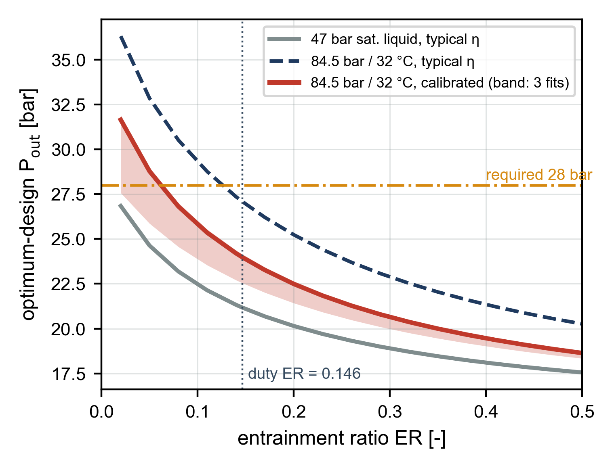

.. _worked_example:

=================================================
Worked Example: CO\ :sub:`2` Vapour Recompression
=================================================

This example uses the model as intended in a flowsheet study: a feasibility
question, answered with the calibrated efficiencies and a stated uncertainty.

The duty
========

Recover CO\ :sub:`2` vapour with a high-pressure CO\ :sub:`2` motive stream:

.. list-table::
   :header-rows: 0
   :widths: 40 60

   * - Motive flow
     - 13.66 kg s\ :sup:`-1`
   * - Suction
     - 2.0 kg s\ :sup:`-1` saturated vapour at 15 bar (−28.5 °C)
   * - Entrainment ratio
     - 0.146
   * - Required outlet pressure
     - 28 bar (lift :math:`\Pi` = 1.87)
   * - Motive options
     - (A) saturated liquid at 47 bar (11.7 °C); (B) dense supercritical fluid at 84.5 bar, 32 °C

All results are **optimum designs** (:ref:`sec-design`). They show the best that
each efficiency set allows, before any real geometry compromises.

.. _fig-duty:

   Optimum-design outlet pressure against entrainment ratio for the two motive
   options. The red band spans the three R744 calibration sets
   (:ref:`sec-val-giacomelli`). The required 28 bar and the duty ER 0.146 are
   marked. Data: ``figures/data/duty_curves.csv``.

Results
=======

.. list-table:: Duty-case results (13.66 kg/s motive). Source: ``figures/data/duty_point.csv``.
   :header-rows: 1
   :widths: 26 18 18 18 20

   * - Motive, efficiency set
     - :math:`P_\mathrm{out}` at ER 0.146 [bar]
     - max. suction at 28 bar [kg/s]
     - motive for 2 kg/s at 28 bar [kg/s]
     - :math:`D_\mathrm{t}` / :math:`D_\mathrm{mix}` [mm], :math:`\eta_\mathrm{ej}`
   * - (A) 47 bar liquid, typical
     - 21.2
     - 0.13
     - (≈ 210)
     - 24.7 / 45.6, 0.31
   * - (B) 84.5 bar, typical
     - 27.1
     - 1.71
     - 15.9
     - 19.4 / 42.8, 0.24
   * - (B) 84.5 bar, R744 all points
     - 24.0
     - 0.83
     - 32.9
     - 18.1 / 45.8, 0.17
   * - (B) 84.5 bar, R744 supercritical
     - 24.2
     - 0.87
     - 31.3
     - 18.1 / 45.5, 0.17
   * - (B) 84.5 bar, R744 subcritical + subcooled
     - 22.5
     - 0.19
     - 145
     - 18.1 / 47.1, 0.14

Throat diameters for the R744 sets include :math:`C_d = 1.138`. The suction
stays far from the triple point in every case: :math:`\sigma = 2.5`–2.8, i.e.
the lowest static pressure is about 2.5 times 5.18 bar or more. Dry ice is not a
risk at this suction pressure. The flashing motive adds vapour, so the outlet
carries 5.5 (A) to 8.3 kg s\ :sup:`-1` (B) of vapour against the 2 kg
s\ :sup:`-1` entrained. Downstream separation and recompression must handle
this load.

Interpretation
==============

* **Liquid motive at 47 bar cannot do the duty.** It reaches 21 bar at the
  required entrainment. 28 bar is essentially its zero-entrainment limit.
* **Dense supercritical motive at 84.5 bar falls short as well, once
  calibrated.** With literature-typical efficiencies it nearly meets the duty
  (27.1 bar). With efficiencies measured on a real R744 ejector the outlet
  drops to 22.5–24.2 bar. Reaching 28 bar with 2 kg/s suction needs 31–33
  kg/s of motive, or about 145 kg/s with the subcritical-fitted set, which
  reaches 28 bar only at an ER of 0.014. The calibration changes the answer
  from "marginal" to "probably no".
* **The uncertainty is dominated by extrapolation, not by the fit.** The duty
  lies outside the calibration data in three directions. Suction pressure is 15
  bar against 24–39 bar, lift is 1.87 against at most 1.6, and the mixing
  diameter is about 45 mm against 2 mm. The worst-fitted calibration points are
  the ones nearest this corner. The model under-predicts entrainment as lift
  rises (:ref:`sec-val-giacomelli`), so the extrapolation biases the verdict
  towards "no". Larger ejectors usually lose less to friction, which would also
  favour the duty, but the model has no size effect to quantify it
  (:ref:`sec-limitations`).
* **The band of the three fitted sets understates the uncertainty.**
  :math:`\eta_\mathrm{m}` was fixed at 0.90 in the calibration and is not
  identified by it: the Giacomelli jet expands only from about 69 to 59 bar
  beyond the throat. Yet it moves the duty answer by ±1.3 bar (22.8, 24.0 and
  25.3 bar for :math:`\eta_\mathrm{m}` = 0.8, 0.9 and 1.0, all-points set),
  as much as the whole three-set band. The efficiencies were also fitted on a
  strongly under-expanded off-design nozzle, where pressure forces carry most
  of the mixing impulse. The design has an ideally expanded jet, where
  :math:`\eta_\mathrm{mix}` acts on about twice the share of it. A fair
  statement is an outlet pressure of roughly 22–25 bar at the duty ER:
  probably short of 28 bar, but not with the confidence a single number
  suggests.
* **The mixing model widens the band upwards.** Constant-pressure mixing,
  fitted on the same 42 points and equally good there, gives 26.3 bar instead
  of 24.0 bar at the duty ER, and 1.47 instead of 0.82 kg/s at 28 bar
  (:ref:`sec-guide-duty`). The calibration data cannot tell the two models
  apart, so the band runs from about 22 to 26 bar. That is still short of 28
  bar, but closer to it.

Options a process engineer would weigh next:

* accept an outlet pressure of about 23–24 bar;
* supply about 30 kg/s of motive;
* use a hybrid, with the ejector lifting to about 22 bar and a compressor
  covering the rest; or
* obtain data closer to the duty (:ref:`sec-datasets`), e.g. low-suction R744
  tests, before committing.
